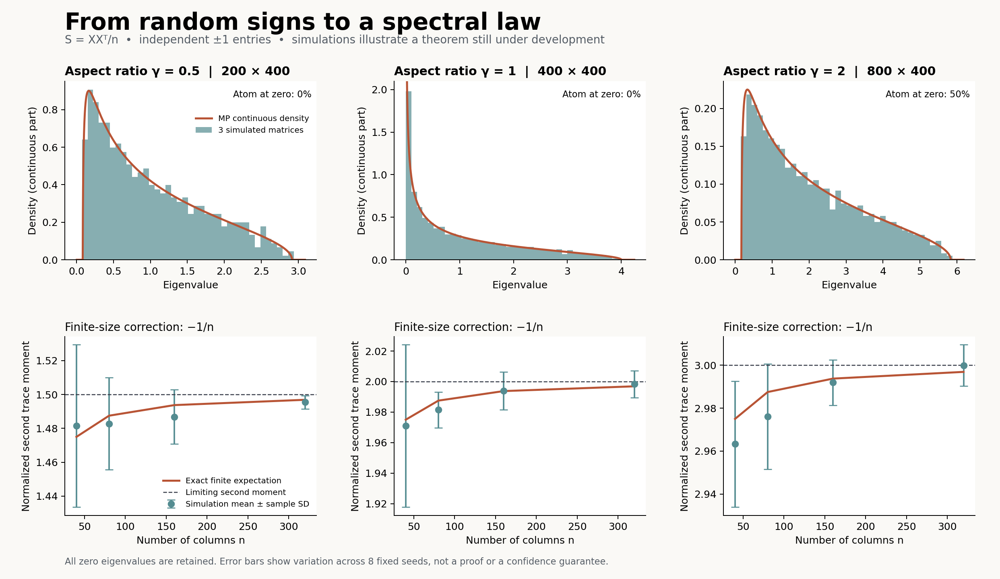

# Random matrices in Lean

A research project toward a complete Lean proof of the Marchenko-Pastur law for
sample covariance matrices with independent fair-sign entries.

The current milestone proves a bijection between leading moment patterns and
rooted ordered trees at every order. Both inverse identities and the separate
row and column block counts are proved. Consequently, each leading coefficient
in the exact finite moment expansion equals the corresponding refined tree
count. The Narayana closed formula and full spectral-distribution theorem
are still open in this project.

The initial finite-moment stage is preserved at the Git tag
`stage-1-finite-moments` (commit `0523463`).
The all-order walk stage is preserved at `stage-2-walk-counting` (`b23f33c`).
The exact coefficient stage is preserved at `stage-3-pattern-coefficients`
(`40eeb1d`). The doubled-tree stage is preserved at `stage-4-doubled-trees`.
The general bijection is preserved at `stage-5-ordered-tree-bijection`.

## Model and conventions

X is p-by-n with independent entries uniform on {-1,+1}. Set

    S = X X^T / n,      M_k = trace(S^k) / p,      gamma = p/n.

Finite expectation is defined as the uniform sum over all 2^(pn) sign
assignments. Both dimensions must be positive in normalized moment theorems.
The flagship target covers gamma > 0, including the zero atom of mass
max(1 - 1/gamma, 0) when gamma > 1.

## Proof modules

| Module | Mathematical content |
| --- | --- |
| FiniteAverage | Uniform expectation and independent-coordinate factorization |
| Rademacher | All-order monomial parity cancellation and rectangle moments |
| WordMoments | Arbitrary coordinate-word moments and mixed moments by multiplicity parity |
| Covariance | Trace expansion, exact first moment, exact expected second moment |
| Geometry | Positive semidefiniteness, rank at most n, nullity at least p-n |
| SecondMomentLimit | Exact second-moment bias and convergence of its expectation |
| Walks | Deterministic expansion at every order; exact expected moments as counts of even closed walks |
| WalkBounds | r+c <= k+1 for even walks; every used entry occurs twice at equality |
| Labelings | Equality-pattern fibers are injective block labelings; exact falling-factorial multiplicities |
| WalkPositions | Bijection between rooted walks and position-indexed row/column assignments |
| WalkPatterns | Closure and parity depend only on partitions; exact partition-weighted count |
| PatternCoefficients | Dimension-independent coefficients and the exact finite moment expansion |
| PatternBounds | Abstract pattern vertex bound and coefficient vanishing above r+c=k+1 |
| PatternBoundary | Exact zeroth-order coefficients and exclusion of empty row/column blocks |
| PatternGraph | Connected bipartite graph on quotient blocks; exact vertex and edge counts |
| PatternTrees | Leading patterns are precisely closed doubled trees, in both directions |
| PatternContour | Genuine graph walks preserving entry order, closure, length, and double occurrence |
| TreeWalkSplit | Bridge-based split into the first child excursion and remaining root excursions |
| OrderedContours | Recursive ordered contours, unique shape, and reconstruction of doubled tree walks |
| CanonicalContours | Canonical distinct vertex labels and injective relabeling of every contour |
| ContourPositions | Even/odd positions and the color-reversing row/column count recurrence |
| ContourEdges | Contour closure and even edge multiplicities |
| ContourLabelings | Fin-indexed row/column label functions, block counts, and ordered entry word |
| ContourPatterns | Every ordered tree produces a surviving maximal original pattern |
| ContourRoundTrip | Recovering the original partitions and full contour through quotient labels |
| LeadingTreeBijection | General bijection, both inverse identities, and preservation of both block counts |
| TreeCoefficients | Fixed-order and refined equivalences; exact leading coefficient as a tree count |

The general finite identity, for every k >= 0 and p,n > 0, is

    E[M_k] = C_k(p,n) / (p n^k),

where C_k counts labeled rooted closed alternating walks with 2k entry visits,
each entry appearing an even number of times. This is a Lean theorem about the
actual finite sign ensemble. In particular, C_0=p and E[M_0]=1.
See [the walk proof guide](docs/WALKS.md) for the encoding and proof chain.

The new partition grouping proves, for every k >= 0,

    C_k(p,n) = sum_(r,c) A_(k,r,c) (p)_r (n)_c,
    A_(k,r,c) = 0 whenever r+c > k+1.

Here A counts surviving equality patterns and (p)_r is the falling factorial.
The coefficients depend on k,r,c only, independently of p and n. See
[the partition proof guide](docs/PATTERNS.md) for the formal bijections.

The new graph characterization is

    surviving pattern with r+c=k+1
      iff closed pattern on a tree with every entry used exactly twice.

This holds at every order, including the empty walk. See
[the doubled-tree proof guide](docs/TREES.md) for the graph constructions.
The new bijection strengthens this to the exact coefficient identity

    A_(k,r,c) = #{ordered rooted trees with k edges, r row and c column vertices},
                                                        whenever r+c=k+1.

The root is a row vertex, and colors alternate with depth. See
[the ordered-tree proof guide](docs/ORDERED_TREES.md) for both inverse maps and
the connection to the original moment coefficients.

The previously proved second-moment specialization is

    E[M_2] = 1 + (p-1)/n = 1 + p/n - 1/n.

For sequences with n tending to infinity and p/n tending to gamma, the expected
second moment therefore tends to 1+gamma. This does not by itself establish
concentration or weak convergence of the random spectral measures.

See [the verification record](docs/VALIDATION.md) for actual build and audit
results. The proof sources are required to contain no unfinished proofs, custom
axioms, or compiler-trust evaluation shortcuts. Standard Lean logical axioms are
allowed and reported explicitly by the audit.

## Build and reproduce

Pinned toolchain: Lean 4.28.0.
Pinned mathlib: 8f9d9cff6bd728b17a24e163c9402775d9e6a365.
The lockfile pins all transitive packages. On this workspace the wrapper uses the
local toolchain under work/. On another machine install Lean through elan, which
reads lean-toolchain.

Fetch the relevant precompiled dependency files once:

```sh
scripts/lake.sh exe cache get \
  Mathlib.LinearAlgebra.Matrix.Rank Mathlib.LinearAlgebra.Matrix.PosDef \
  Mathlib.Data.Real.StarOrdered Mathlib.LinearAlgebra.Matrix.Trace \
  Mathlib.Analysis.SpecificLimits.Basic Mathlib.Tactic.Ring \
  Mathlib.Tactic.NormNum Mathlib.Tactic.FieldSimp Mathlib.Tactic.Linarith \
  Mathlib.Algebra.BigOperators.Group.List.Basic \
  Mathlib.Data.Fintype.CardEmbedding Mathlib.Data.Setoid.Basic \
  Mathlib.Data.Fintype.Powerset Mathlib.Data.Finite.Card Mathlib.Data.Fin.Tuple.Basic \
  Mathlib.Combinatorics.SimpleGraph.Acyclic Mathlib.Data.Tree.Basic
scripts/check.sh
```

The exact experiment uses only the Python standard library:

```sh
python3 experiments/exact_moments.py
python3 experiments/tree_patterns.py
```

The optional plots use the pinned requirements:

```sh
python3 -m venv .venv
.venv/bin/pip install -r experiments/requirements.txt
.venv/bin/python experiments/simulate.py
```

Dependencies and generated compiler artifacts live in .lake/, which is excluded
from source archives. No paid compute is required for this milestone.

## Experiments and their evidential status

The exact checker enumerates 4,774 sign matrices over eight small dimension
pairs, independently comparing direct matrix multiplication with partition
counts for the first four moments. Another 40 checks compare the rooted walk
encoding with partition counts, including the empty-walk case. It also checks
leading Narayana coefficients through order seven using exact integers.
The position-partition encoding is independently checked at orders 0 through 7,
and exhaustive assignments check 120 labeling fibers, including empty domains
and insufficient label counts. The general partition grouping and coefficient
support bound are now proved in Lean. The all-order Narayana formula remains open.

The graph checker independently verifies 189,455 partition graphs at orders
0 through 6. An independent implementation checks both bijection inverses on all 626 trees
at orders 0 through 7, as well as the first-child representation, canonical
contour, and color-count recurrence. The graph classification and general
bijection are now proved in Lean. The Python implementation itself is not
formally verified.

The spectral figure uses 105 reproducible simulated matrices. It preserves
structural zero eigenvalues for p > n and shows the finite -1/n bias in the
second moment. Its histograms and error bars are illustrations, not formal
proofs or evidence of a new mathematical result.



## The substantial work ahead

[BLUEPRINT.md](docs/BLUEPRINT.md) gives the exact theorem and dependency graph.
The next major step is to evaluate the refined ordered-tree count by the
Narayana formula. The underlying graph classification and ordered-tree
bijection are complete. Subsequent bottlenecks are
expected-moment limits, variance estimates,
formal spectral measures, identification of the MP density plus atom, and
moment-to-measure convergence.

[PRIOR_ART.md](docs/PRIOR_ART.md) records the inspected existing projects and their
limitations. This is a formalization of a classical result. No claim of novelty
or first formalization has been established.
